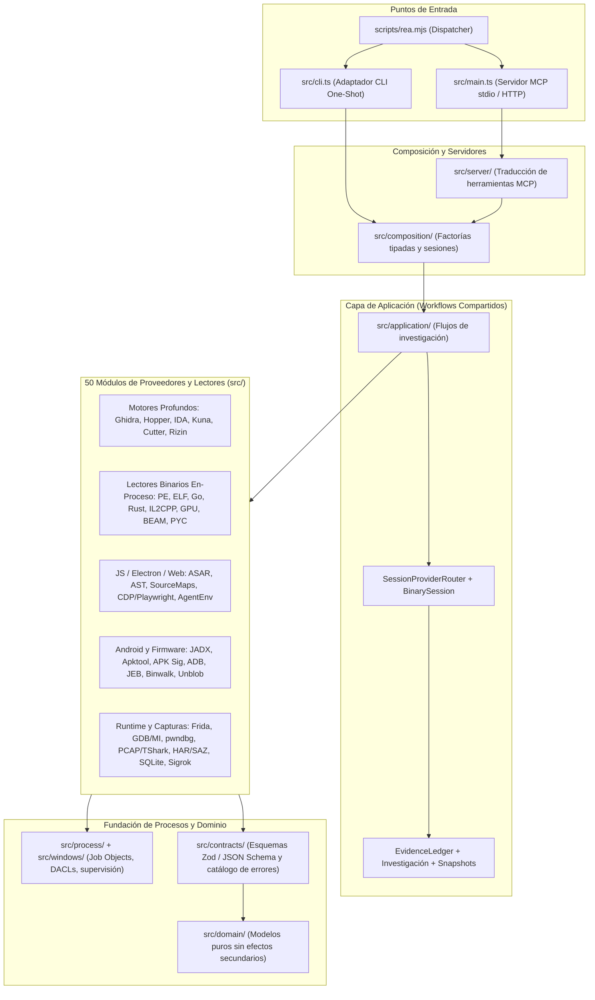

# Base de Conocimiento y Análisis Completo: REA (Reverse Engineer Anything)

> [!IMPORTANT]
> **Ubicación detectada en tu perfil de GitHub y en tu PC:**
> - **Repositorio en GitHub:** `https://github.com/andresgarcia-max/xview` (carpeta `rea/`, commit `01513a7`: *"Agregar repositorio completo morluto/rea"*)
> - **Ruta local en tu PC:** [rea](file:///C:/Users/CORSAIR/Desktop/xview/rea)
> - **Paquete y versión:** `rea-agents` **v6.8.0** (`io.github.morluto/rea`) — [package.json](file:///C:/Users/CORSAIR/Desktop/xview/rea/package.json#L1-L48)
> - **Skills instaladas en tu Antigravity:** Copiadas en [.gemini/config/skills](file:///C:/Users/CORSAIR/.gemini/config/skills) y en [.agents/skills](file:///c:/Users/CORSAIR/Desktop/metal%20slug/.agents/skills).

---

## 1. ¿Qué es REA y cuál es su propósito?

**REA (`Reverse Engineer Anything`)** es una plataforma unificada de ingeniería inversa **100% local** diseñada tanto para agentes de IA (mediante un servidor **MCP — Model Context Protocol**) como para uso directo en terminal (**CLI**).

Su filosofía central ([AGENTS.md](file:///C:/Users/CORSAIR/Desktop/xview/rea/AGENTS.md#L3-L14)) se basa en:
1. **Separación estricta de hechos:** Distingue explícitamente entre **observaciones directas** (*observations*), **derivaciones** (*derivations*), **inferencias** (*inferences*) e **incógnitas residuales** (*unknowns*).
2. **Trazabilidad criptográfica (`EvidenceLedger`):** Cada hallazgo devuelve un registro inmutable `Evidence` con hashes `SHA-256`, rangos de bytes exactos, perfil de análisis (`analysis_profile`), cobertura (`coverage`) y limitaciones declaradas.
3. **Ejecución aislada y segura (*Fail-Closed*):** Las herramientas estáticas jamás ejecutan el binario objetivo. Los procesos hijos están supervisados mediante *Windows Job Objects* ([native/windows](file:///C:/Users/CORSAIR/Desktop/xview/rea/native/windows)) o grupos de procesos POSIX con límites estrictos de memoria, tiempo y descriptores.

---

## 2. Arquitectura del Sistema

La arquitectura sigue una regla de dependencias hacia adentro (*Clean/Hexagonal Architecture*), documentada en [architecture.mermaid](file:///C:/Users/CORSAIR/Desktop/xview/rea/docs/architecture.mermaid):

---

## 3. Catálogo de los 50 Módulos en `src/` y Puentes (`bridge/`)

### A. Ingeniería Inversa de Binarios Nativos (Proveedores Profundos)
| Módulo / Puente | Función Principal |
| :--- | :--- |
| [src/ghidra](file:///C:/Users/CORSAIR/Desktop/xview/rea/src/ghidra) + [ReaGhidraBridge.java](file:///C:/Users/CORSAIR/Desktop/xview/rea/bridge/ghidra/ReaGhidraBridge.java) | Análisis profundo headless con bases de datos efímeras: descompilación a C, ensamblador, CFG, referencias cruzadas (`xrefs`), soporte para x86/x64, ARM/AArch64, MIPS, PowerPC, RISC-V, 6502, M68k, DOS 16-bit, GameCube DOL, PSP y .NET NativeAOT. |
| [src/hopper](file:///C:/Users/CORSAIR/Desktop/xview/rea/src/hopper) + [hopper_bridge.py](file:///C:/Users/CORSAIR/Desktop/xview/rea/bridge/hopper_bridge.py) | Automatización de Hopper Disassembler mediante socket Unix para pseudocódigo, CFG y referencias. |
| [src/ida](file:///C:/Users/CORSAIR/Desktop/xview/rea/src/ida) | Adaptador de solo lectura para IDA Pro (instancia GUI adjunta por SHA-256 o base de datos headless privada vía MCP). |
| [src/kuna](file:///C:/Users/CORSAIR/Desktop/xview/rea/src/kuna) | Integración con el descompilador Kuna mediante exportación de programa completo en caché (`.c` / `.asm`). |
| [src/cutter](file:///C:/Users/CORSAIR/Desktop/xview/rea/src/cutter) + [rea_bridge.py](file:///C:/Users/CORSAIR/Desktop/xview/rea/bridge/cutter/rea_bridge.py) | Puente en vivo para Cutter / Rizin GUI. |
| [src/rizin](file:///C:/Users/CORSAIR/Desktop/xview/rea/src/rizin) y [src/objdump](file:///C:/Users/CORSAIR/Desktop/xview/rea/src/objdump) | Perfiles de inspección estática con Rizin y GNU `objdump`. |

### B. Inspección Estática Integrada (Sin Desensamblador Externo)
Estos módulos leen los formatos directamente en Node.js sin requerir Ghidra, IDA ni ejecutar el binario:
- **Ejecutables Windows (PE32/PE32+):**
  - `inspect_pe_imports`: Tablas de importación (`ILT`/`IAT`), *delay-load*, ordinales e *imphash*.
  - `inspect_pe_certificates`: Certificados Authenticode `WIN_CERTIFICATE` y firmantes PKCS#7 / X.509.
  - `inspect_pe_load_config`: Callbacks TLS, `SafeSEH`, `CFG` (Control Flow Guard), `SecurityCookie` y `XFG`.
  - `inspect_pe_resources` y `inspect_native_exports`: Árboles de recursos, iconos y tabla de exportaciones.
- **Motores de Videojuegos y Metadatos Compilados:**
  - [src/il2cpp](file:///C:/Users/CORSAIR/Desktop/xview/rea/src/il2cpp) (`inspect_il2cpp_metadata`): Decodifica `global-metadata.dat` de Unity (versiones 24, 27, 29, 31 y 39), extrayendo ensamblados, clases, métodos, campos y literales de texto, y vinculándolos opcionalmente con el binario nativo.
  - **Godot PCK** (`inspect_artifact` / `extract_artifact`): Inventario y extracción de paquetes `.pck` de Godot (formatos 2, 3 y 4).
  - [src/dotnet](file:///C:/Users/CORSAIR/Desktop/xview/rea/src/dotnet) (`inspect_managed_artifact` / `inspect_managed_members`): Lector estático de ensamblados `.NET` (PE/CLI) e instrucciones CIL.
  - [src/go](file:///C:/Users/CORSAIR/Desktop/xview/rea/src/go) (`inspect_go_binary`): Extrae versión del compilador Go, módulos integrados, reemplazos y flags de compilación en ELF/PE/Mach-O.
  - [src/rust](file:///C:/Users/CORSAIR/Desktop/xview/rea/src/rust) (`inspect_rust_binary`): Extrae el grafo de crates `cargo-auditable` (`.dep-v0`) y el hash de commit de `rustc`.
- **IA, GPU, Máquina Virtual y Lenguajes:**
  - [src/model](file:///C:/Users/CORSAIR/Desktop/xview/rea/src/model) (`inspect_model_artifact`): Inspecciona cabeceras y tensores de modelos **GGUF** y **safetensors**.
  - [src/gpu](file:///C:/Users/CORSAIR/Desktop/xview/rea/src/gpu) (`inspect_gpu_code_objects`): Extrae objetos CUDA/HIP (`fatbin`, `CUBIN`) y código `PTX`.
  - [src/python](file:///C:/Users/CORSAIR/Desktop/xview/rea/src/python) (`inspect_python_pyc` + soporte **PyInstaller**): Analiza archivos `.pyc` (CPython 3.7–3.13) y contenedores `CArchive`/`PYZ` de ejecutables PyInstaller.
  - [src/erlang](file:///C:/Users/CORSAIR/Desktop/xview/rea/src/erlang) (`inspect_erlang_beam`): Decodifica contenedores IFF `.beam` de Erlang/Elixir.
  - [src/wasm](file:///C:/Users/CORSAIR/Desktop/xview/rea/src/wasm) (`inspect_wasm_artifact`): Valida y convierte WebAssembly a WAT mediante WABT.
  - [src/evm](file:///C:/Users/CORSAIR/Desktop/xview/rea/src/evm) (`inspect_evm_interface`): Infiere selectores de funciones, argumentos y mutabilidad de bytecode Ethereum (EVM) usando EVMole en WASM.
  - [src/sqlite](file:///C:/Users/CORSAIR/Desktop/xview/rea/src/sqlite) (`inspect_sqlite_database`): Inspecciona esquemas, tablas, vistas, triggers y filas de bases SQLite + archivos WAL.

### C. Aplicaciones JavaScript, Electron, Web y Entornos RL (`AgentEnv`)
- [src/javascript](file:///C:/Users/CORSAIR/Desktop/xview/rea/src/javascript) y [src/electron](file:///C:/Users/CORSAIR/Desktop/xview/rea/src/electron):
  - `analyze_javascript_application`: Reconstruye el grafo completo de módulos, importaciones, rutas, canales IPC (`ipcMain`/`ipcRenderer`/`contextBridge`) y addons nativos `.node` desde directorios o paquetes `.asar` sin ejecutarlos.
  - `inspect_electron_fuses`: Verifica los *fuses* de seguridad empaquetados en el binario de Electron (ej. si permite `--inspect`).
- [src/browser](file:///C:/Users/CORSAIR/Desktop/xview/rea/src/browser) y [src/inspector](file:///C:/Users/CORSAIR/Desktop/xview/rea/src/inspector):
  - Observación en vivo mediante Chrome DevTools Protocol (CDP) y Playwright (`capture_browser_scenario`), atribución de red/DOM a ubicaciones exactas de código fuente mediante Source Maps.
  - **Generación de entornos RL (`export_environment_bundle`):** Convierte sesiones web grabadas o archivos HAR en entornos locales ejecutables (`AgentEnv`) para entrenar o evaluar agentes de IA.

### D. Android, Apple, Firmware, Redes y Depuración Dinámica
- **Android y Móvil:**
  - [src/android](file:///C:/Users/CORSAIR/Desktop/xview/rea/src/android) + [ReaJadxBridge.java](file:///C:/Users/CORSAIR/Desktop/xview/rea/bridge/android/ReaJadxBridge.java): Descompilación de APKs con JADX headless (`inspect_android_package`).
  - [src/apkSignature](file:///C:/Users/CORSAIR/Desktop/xview/rea/src/apkSignature) (`inspect_apk_signature`): Verificación estática de bloques de firma APK v1, v2, v3 y v3.1 y linaje de rotación de claves.
  - [src/apktool](file:///C:/Users/CORSAIR/Desktop/xview/rea/src/apktool), [src/adb](file:///C:/Users/CORSAIR/Desktop/xview/rea/src/adb), [src/jeb](file:///C:/Users/CORSAIR/Desktop/xview/rea/src/jeb) y [src/flutter](file:///C:/Users/CORSAIR/Desktop/xview/rea/src/flutter): Decodificación de recursos Android, adquisición por ADB, integración con JEB Decompiler y análisis de snapshots Dart/Flutter (`libapp.so` / `libflutter.so`).
- **Firmware y Hardware (Ideal para proyectos como tu ZTE B866V2 / Xview):**
  - [src/firmware](file:///C:/Users/CORSAIR/Desktop/xview/rea/src/firmware): Escaneo de regiones y extracción segura con **Binwalk** y **Unblob**, más soporte para **DeviceTree (`.dtb`/`.dts`)** y módulos de kernel Linux (`inspect_kernel_module`).
  - [src/captures](file:///C:/Users/CORSAIR/Desktop/xview/rea/src/captures), [src/pcap](file:///C:/Users/CORSAIR/Desktop/xview/rea/src/pcap) y [src/signals](file:///C:/Users/CORSAIR/Desktop/xview/rea/src/signals): Inspección de capturas `PCAP`/`PCAPNG` (vía TShark/capinfos), tráfico HTTP/3 `qlog`, `HAR`, `Fiddler SAZ`, `mitmproxy` y señales lógicas de hardware con `sigrok-cli`.
- **Instrumentación Dinámica:**
  - [src/frida](file:///C:/Users/CORSAIR/Desktop/xview/rea/src/frida), [src/gdb](file:///C:/Users/CORSAIR/Desktop/xview/rea/src/gdb), [bridge/pwndbg](file:///C:/Users/CORSAIR/Desktop/xview/rea/bridge/pwndbg) y [rea_lldb_tracer.py](file:///C:/Users/CORSAIR/Desktop/xview/rea/bridge/native/rea_lldb_tracer.py): Sesiones persistentes de depuración e instrumentación en tiempo de ejecución.

---

## 4. Flujo de Trabajo Recomendado (`Summary-First`)

Según la skill oficial [SKILL.md](file:///C:/Users/CORSAIR/Desktop/xview/rea/.agents/skills/reverse-engineer-anything/SKILL.md#L400-L445), REA optimiza el consumo de tokens de los agentes siguiendo tres reglas:

1. **Enrutar primero según el artefacto (`Route the target first`):**
   - Si el objetivo es un ejecutable Windows (ej. `MetalSlug.exe` en tu carpeta actual), usar primero las herramientas estáticas sin motor (`inspect_pe_imports`, `inspect_pe_resources`, `inspect_pe_certificates`, `inspect_pe_load_config`, `inspect_native_exports`) y después `open_binary` con Ghidra/Hopper/IDA si se requiere descompilar funciones.
   - Si es un contenedor o instalador, usar `open_binary` + `inspect_artifact`.
   - Si es una app JS/Electron, usar `analyze_javascript_application` con `"detail": "summary"`.
2. **Paginación sobre Evidencia Retenida (`inspect_analysis_view`):**
   - Nunca pedir volcados masivos en línea. Usar el `parent_evidence_id` devuelto por el resumen para consultar páginas específicas (`native-inventory`, `modules`, `model-artifact`, `il2cpp`, etc.).
3. **Requisitos de Node.js:**
   - El paquete actual `rea-agents@6.8.0` declara en `engines.node`: `^22.23.4 || ^24.22.1 || >=26.12.1` ([package.json](file:///C:/Users/CORSAIR/Desktop/xview/rea/package.json#L45-L47)). En tu equipo actualmente tienes `Node.js v20.18.0`, por lo que para compilar o ejecutar el servidor MCP de `rea` localmente conviene actualizar Node.js a **v22 LTS** o **v24 LTS**.

---

## 5. Skills de REA Instaladas en tu Antigravity

Se han instalado las **5 skills oficiales** de REA tanto a nivel global ([.gemini/config/skills](file:///C:/Users/CORSAIR/.gemini/config/skills)) como en tu workspace actual ([.agents/skills](file:///c:/Users/CORSAIR/Desktop/metal%20slug/.agents/skills)):

1. **`reverse-engineer-anything`** ([SKILL.md](file:///C:/Users/CORSAIR/Desktop/xview/rea/.agents/skills/reverse-engineer-anything/SKILL.md)) — Guía maestra de investigación y enrutamiento de herramientas, junto con sus 7 manuales de referencia:
   - [native-and-artifacts.md](file:///C:/Users/CORSAIR/Desktop/xview/rea/.agents/skills/reverse-engineer-anything/references/native-and-artifacts.md) (Binarios nativos, Ghidra, IDA, Hopper, archivos y extracción)
   - [javascript-applications.md](file:///C:/Users/CORSAIR/Desktop/xview/rea/.agents/skills/reverse-engineer-anything/references/javascript-applications.md) (Apps JS/Electron, ASAR y trazado de features)
   - [android-applications.md](file:///C:/Users/CORSAIR/Desktop/xview/rea/.agents/skills/reverse-engineer-anything/references/android-applications.md) (APKs, JADX, manifiestos y firmas)
   - [runtime-observation.md](file:///C:/Users/CORSAIR/Desktop/xview/rea/.agents/skills/reverse-engineer-anything/references/runtime-observation.md) (Frida, GDB, navegador CDP, Electron en vivo y Fiddler)
   - [evidence-workflows.md](file:///C:/Users/CORSAIR/Desktop/xview/rea/.agents/skills/reverse-engineer-anything/references/evidence-workflows.md) (Paginación de evidencia, comparaciones e incógnitas)
   - [environments.md](file:///C:/Users/CORSAIR/Desktop/xview/rea/.agents/skills/reverse-engineer-anything/references/environments.md) (Creación de entornos RL `AgentEnv`)
   - [connection-and-recovery.md](file:///C:/Users/CORSAIR/Desktop/xview/rea/.agents/skills/reverse-engineer-anything/references/connection-and-recovery.md) (Diagnóstico con `rea doctor`, `rea setup --client antigravity` y recuperación de timeouts)
2. **`rea-analysis-optimization`** — Optimización de tokens, tiempo de análisis y memoria en flujos de ingeniería inversa.
3. **`rea-tool-design`** — Diseño de contratos y herramientas orientadas a evidencia.
4. **`rea-ci-tests-audit`** — Auditoría de pruebas de frontera y rendimiento en CI.
5. **`rea-changelog-update`** — Mantenimiento de notas de versión basadas en commits verificados.
