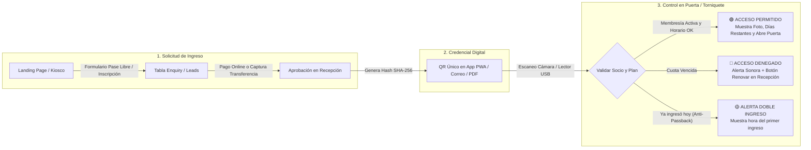

# Análisis Integral: Control de Accesos, Diseño UI/UX y Gestión de Gimnasios

Todos los repositorios gratuitos y de código abierto han sido descargados y descomprimidos dentro de la carpeta única [`repositorios/`](file:///c:/Users/andre/OneDrive/Desktop/gym/repositorios), junto con un índice maestro en [`ANALISIS_Y_CATALOGO_COMPLETO.md`](file:///c:/Users/andre/OneDrive/Desktop/gym/repositorios/ANALISIS_Y_CATALOGO_COMPLETO.md).

---

## 🖼️ 1. Galería Visual de Diseños Descargados (UI/UX, Dashboards y Landing Pages)

````carousel

<!-- slide -->

<!-- slide -->

<!-- slide -->

<!-- slide -->

<!-- slide -->

````

---

## 📦 2. Los 10 Repositorios Descargados y su Propósito

| Carpeta Local | Tecnologías | Lo mejor para extraer / reutilizar |
| :--- | :--- | :--- |
| **[`GimnasioQR-main`](file:///c:/Users/andre/OneDrive/Desktop/gym/repositorios/GimnasioQR-main/README.md)** | Python, Django 5, JS QR Scanner, PDF | **Control de Acceso QR en Español:** Validación en tiempo real ([`access_views.py`](file:///c:/Users/andre/OneDrive/Desktop/gym/repositorios/GimnasioQR-main/Clientes/views/access_views.py)), generación de hashes `SHA-256` por RUT/DNI ([`models.py`](file:///c:/Users/andre/OneDrive/Desktop/gym/repositorios/GimnasioQR-main/Clientes/models.py)), control de doble ingreso diario y contratos PDF. |
| **[`GymPulse-main`](file:///c:/Users/andre/OneDrive/Desktop/gym/repositorios/GymPulse-main/README.md)** | Go, React (Admin + PWA), Vue, Postgres | **Ecosistema Triple (Recepción + App Socio + Web):** Flujo de solicitud de ingreso/renovación subiendo captura de transferencia, QR en celular del socio y lista de *"Presentes ahora en el gym"*. |
| **[`gyms-master`](file:///c:/Users/andre/OneDrive/Desktop/gym/repositorios/gyms-master/README.md)** | Python (CustomTkinter), OpenCV, SQLite | **Kiosco / Escritorio con Cámara:** Escaneo QR directo por webcam en recepción, alertas SMS y separación de QRs para socios, entrenadores y empleados. |
| **[`gym-management-main`](file:///c:/Users/andre/OneDrive/Desktop/gym/repositorios/gym-management-main/README.md)** | Next.js, TypeScript, Tailwind, Shadcn, Prisma | **Solicitudes de Ingreso (`Enquiry`) y Banco de Ejercicios:** Modelo de prospectos por WhatsApp/Instagram/Walk-in ([`schema.prisma`](file:///c:/Users/andre/OneDrive/Desktop/gym/repositorios/gym-management-main/prisma/schema.prisma)) y +50 imágenes/GIFs de ejercicios en [`public/exercises/`](file:///c:/Users/andre/OneDrive/Desktop/gym/repositorios/gym-management-main/public/exercises). |
| **[`voltfit-dashboard-main`](file:///c:/Users/andre/OneDrive/Desktop/gym/repositorios/voltfit-dashboard-main/README.md)** | React 18, Vite 5, Tailwind CSS | **Analítica y Control de Aforo:** Tarjetas KPI de capacidad del gimnasio en vivo, membresías por vencer y métricas financieras ([`src/components/`](file:///c:/Users/andre/OneDrive/Desktop/gym/repositorios/voltfit-dashboard-main/src/components)). |
| **[`GymMaster-main`](file:///c:/Users/andre/OneDrive/Desktop/gym/repositorios/GymMaster-main/README.md)** | React, Tailwind CSS | **UI Modular de Administración:** Vistas limpias para gestión de entrenadores, planes y pagos. |
| **[`GYM-One-main`](file:///c:/Users/andre/OneDrive/Desktop/gym/repositorios/GYM-One-main/README.md)** | PHP, MySQL, Bootstrap | **Operación de Recepción y Pases Diarios:** Venta de tickets por día, control de casilleros/entradas y reglas del gimnasio. |
| **[`responsive-gym-website-main`](file:///c:/Users/andre/OneDrive/Desktop/gym/repositorios/responsive-gym-website-main/index.html)** | HTML5, CSS3, JS, ScrollReveal | **Diseño *Cyber-Lime* y Calculadora IMC:** Paleta oscura con verde lima eléctrico ([`styles.css`](file:///c:/Users/andre/OneDrive/Desktop/gym/repositorios/responsive-gym-website-main/assets/css/styles.css)), calculadora interactiva de índice de masa corporal y fotos transparentes en PNG ([`assets/img/`](file:///c:/Users/andre/OneDrive/Desktop/gym/repositorios/responsive-gym-website-main/assets/img)). |
| **[`fitlife-master`](file:///c:/Users/andre/OneDrive/Desktop/gym/repositorios/fitlife-master/index.html)** | HTML5, CSS3, JS Vanilla | **Diseño *Fire & Iron* y Banners de Video:** Estética agresiva de alto contraste ([`style.css`](file:///c:/Users/andre/OneDrive/Desktop/gym/repositorios/fitlife-master/assets/css/style.css)), vectores circulares animados y sección de video promocional ([`assets/images/`](file:///c:/Users/andre/OneDrive/Desktop/gym/repositorios/fitlife-master/assets/images)). |
| **[`futras-master`](file:///c:/Users/andre/OneDrive/Desktop/gym/repositorios/futras-master/index.html)** | HTML5, CSS3, JS Vanilla | **Diseño *Wellness & Fitness*:** Paleta verde bosque y naranja dorado ([`style.css`](file:///c:/Users/andre/OneDrive/Desktop/gym/repositorios/futras-master/assets/css/style.css)), ideal para gimnasios con clases grupales, yoga o nutrición. |

---

## 🔐 3. Arquitectura de Control de Acceso y Solicitudes de Ingreso

A partir del análisis del código fuente de [`GimnasioQR`](file:///c:/Users/andre/OneDrive/Desktop/gym/repositorios/GimnasioQR-main/Clientes/views/access_views.py#L10-L144) y [`GymPulse`](file:///c:/Users/andre/OneDrive/Desktop/gym/repositorios/GymPulse-main/README.md), este es el flujo más robusto y económico para implementar en tu gimnasio:



### Ideas Clave Extraídas para tu Sistema:
1. **Seguridad Anti-Clonación de QR (`Anti-Passback`):** En [`access_views.py`](file:///c:/Users/andre/OneDrive/Desktop/gym/repositorios/GimnasioQR-main/Clientes/views/access_views.py#L76-L116), el sistema verifica si el socio ya registró una entrada permitida en el rango del día actual (`00:00:00` a `23:59:59`). Esto evita que un socio le pase una captura de pantalla de su QR a un amigo para entrar detrás de él.
2. **Validación de Pagos por Captura de Pantalla:** En [`GymPulse`](file:///c:/Users/andre/OneDrive/Desktop/gym/repositorios/GymPulse-main/README.md#L39), los socios suben el comprobante de transferencia desde su celular y el recepcionista tiene una bandeja de *"Solicitudes Pendientes"* para aprobar la membresía con un solo clic sin depender de pasarelas bancarias costosas.
3. **Pantalla de Monitor en Entrada:** Mostrar en pantalla completa tras cada escaneo:
   - **Nombre y Foto del Socio** (para verificación visual rápida).
   - **Semáforo de Estado:** Verde (`¡Bienvenido!`), Amarillo (`Tu plan vence en 3 días`), Rojo (`Membresía vencida el DD/MM/AAAA`).
   - **Racha de Motivación:** *"¡Visita #14 de este mes, sigue así!"* (implementado en [`access_views.py`](file:///c:/Users/andre/OneDrive/Desktop/gym/repositorios/GimnasioQR-main/Clientes/views/access_views.py#L126-L142) con `monthly_access`).

---

## 🎨 4. Sistemas de Colores, Tipografías y Activos Multimedia Listos para Usar

### Paletas de Colores (Variables CSS listas para copiar)

* **Opción 1: Dark Neon Lime (Moderna / Tech / 24-7)** — de [`responsive-gym-website`](file:///c:/Users/andre/OneDrive/Desktop/gym/repositorios/responsive-gym-website-main/assets/css/styles.css#L10-L20)
  * Fondo Principal: `#121717` (`hsl(180, 12%, 8%)`)
  * Acento Neón (Botones, Bordes activos, QR válido): `#A3E038` (`hsl(79, 72%, 55%)`)
  * Brillo Hover: `#D9FD8B` (`hsl(79, 97%, 77%)`)
  * Tipografía: `Red Hat Display` (900 Black) + `Kaushan Script` (para subtítulos dinámicos).

* **Opción 2: High-Contrast Crimson/Orange (Fuerza / CrossFit / Musculación)** — de [`fitlife`](file:///c:/Users/andre/OneDrive/Desktop/gym/repositorios/fitlife-master/assets/css/style.css#L23-L37)
  * Fondo Ultra Oscuro: `#050A0F` (`hsl(210, 50%, 4%)`)
  * Superficie de Tarjetas: `#151C24` (`hsl(210, 26%, 11%)`)
  * Acento Primario (*Coquelicot*): `#FD3D0B` (`hsl(12, 98%, 52%)`)
  * Sombra Glow en Botones: `0px 10px 24px hsla(12, 98%, 52%, 0.2)`
  * Tipografía: `Catamaran` (800/900) + `Rubik`.

### Banco de Imágenes, Iconos y Recursos Descargados en tu Carpeta
Puedes usar directamente cualquiera de estos recursos gráficos que ya están en tu disco:
* **Atletas recortados en PNG (sin fondo), íconos de pesas y fondos de video:**
  * [`repositorios/fitlife-master/assets/images/`](file:///c:/Users/andre/OneDrive/Desktop/gym/repositorios/fitlife-master/assets/images) (`hero-banner.png`, `video-banner.jpg`, `class-icon-1..4.png`, círculos animados).
  * [`repositorios/responsive-gym-website-main/assets/img/`](file:///c:/Users/andre/OneDrive/Desktop/gym/repositorios/responsive-gym-website-main/assets/img) (`home-img.png`, `choose-img.png`, `calculate-img.png`, `program1..4.png`).
* **Catálogo visual de ejercicios por grupo muscular:**
  * [`repositorios/gym-management-main/public/exercises/`](file:///c:/Users/andre/OneDrive/Desktop/gym/repositorios/gym-management-main/public/exercises)
* **Iconos de interfaz para control de acceso y códigos QR de prueba:**
  * [`repositorios/gyms-master/templates/`](file:///c:/Users/andre/OneDrive/Desktop/gym/repositorios/gyms-master/templates)
